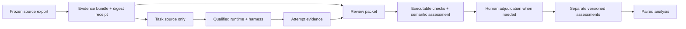

# Architecture

The Python package has five boundaries: typed experimental records, captured
evidence, runtime qualification, harness observations, and separate assessments.
The CLI coordinates them through explicit files. It has no database, persistent
daemon, or dependency on another local repository. An explicit bounded gateway
can broker native Codex inference; ordinary imports and checks do not start it
or read credentials.

This diagram is the target scored flow. Prepared-image task/Git controls,
synthetic and authenticated native tool controls, packets, assessments, and
authored-label comparisons execute today. An externally invoked development
judge has assessed the authored controls. Bounded environment admission is
implemented; independent judge calibration and paired scored dispatch/analysis
remain incomplete.

## Records

`contracts.py` exposes provisional version-1 JSON schemas. Unknown fields are
rejected. Task identifies evidence and development/holdout population. Experiment
declares tasks, harness/model/effort, variants, repetitions, order seed, timeout,
and primary outcomes. A variant distinguishes absent, available, and forced skill
use and pins skill content when present. These are starting contracts, not a
complete admissible campaign specification.

Attempt separates execution status, evidence identity, observed consultation,
origin, and reported usage. Missing usage is null. Assessment names its subject,
evidence digest, rubric, assessor, model when applicable, per-finding judgments,
limitations, and optional superseded record. Structural validation does not
establish the truth of any of these claims or enforce relationships across a full
campaign; orchestration must add those checks.

## Evidence

Capture produces a fresh directory containing payload and `manifest.json`. Each
manifest entry records relative path, SHA-256, byte count, and executable flag.
Verification rejects extra/missing files, changed bytes/modes, duplicate paths,
unsafe paths, links, and nonregular files. JSON controls reject duplicate keys and
nonfinite numbers. Reads and copies are bounded.

Publication uses an atomic no-replace rename. Captured files are made read-only;
the owner can still modify them. Keep the manifest digest outside the bundle to
detect replacement of both manifest and payload. This is integrity checking, not
a signature, provenance proof, multi-file source snapshot, or storage durability
guarantee across power failure. Freeze the source before importing.

Historical imports preserve selected case files and reports plus the original
full report document under `provenance/`. They explicitly record development
population, prior exposure, and unverified earlier custody. The whole bundle can
contain private material. Only `case/source` is eligible for solver transfer;
oracle, reports, and provenance are grading inputs outside that filesystem.

Private records use fresh destinations and restrictive file permissions. These
are local workflow protections, not isolation from the credential-owning user or
another process with the same authority. No scrubber makes arbitrary source or
traces publishable. Release artifacts require an explicit visibility review.

## Native review reconstruction

`workspace.py` exports only captured task source into a fresh writable directory,
requiring the separately retained manifest digest. For the supported schema-1
review metadata and full-identity UTF-8 patch format, native Git plumbing checks
candidate blobs/modes, reverse-applies the patch, verifies base identities, and
round-trips to the exact candidate tree. Synthetic `base` and `candidate` commits
provide a meaningful native diff; original history is unavailable.

Captured ordinary instructions, tests, ignored files, bytes, and executable modes
are retained. Oracle, reports, and provenance do not enter the workspace. Git
configuration is isolated, and plumbing avoids checkout, hooks, attributes,
filters, and task-program execution. Unsupported paths, patch forms, mode types,
and case aliases fail closed. Offline exact-diff reconstruction has been exercised
on a captured real review. The same review also passed native guest Git checks
and its repository tests on the selected dependency image.

## Runtime and harness

`qualification.py` makes a plan from a verified imported source bundle, pinned
registry OCI digest or local Docker-save archive SHA-256, resources, and explicit
guest command argv. `run` recomputes the plan and rejects drift before launching
anything. It uses a fresh machine identity, isolated HOME/XDG/Docker directories,
an allowlisted process environment, no host
shell, bounded logs, timeouts, and stop/delete cleanup receipts. The runtime HOME
uses a short private temporary path because macOS socket paths include HOME-based
cache directories even when XDG directories are short. It transfers a hash-checked
archive of source files only. Nothing in the imported tree is executed directly
on the host.

The candidate adapter is pinned to the inspected smolvm 1.32.3 CLI. Executable
registry plans are restricted to explicit `docker.io/` references: this version's
pack resolver skips Docker Hub, while other registry references can automatically
import packed-machine policy, including network settings. Ordinary OCI pulls may
contact a public registry from the host; that is distinct from guest network
policy. The offline adapter requests no guest network, mounts, or secrets. The separate
native control mounts only the declared inference socket. The separate
[environment admission workflow](ENVIRONMENT.md) requires evidence for the exact
selected route, including adversarial lifecycle controls.

The adapter follows the pinned upstream
[machine CLI](https://github.com/smol-machines/smolvm/blob/v1.32.3/src/cli/machine.rs),
[pack resolver](https://github.com/smol-machines/smolvm/blob/v1.32.3/src/data/pack_ref.rs),
and [VM lifecycle](https://github.com/smol-machines/smolvm/blob/v1.32.3/src/cli/vm_common.rs).
Reinspect and requalify before accepting another runtime version or image route.
Colima remains an alternative to evaluate, not an implemented fallback.

`offline_passed` records successful explicit offline controls and cleanup.
`partial` covers failures, incomplete cleanup, or a mismatched runtime. Every
report says `admitted: false`. No installed binary, source-level restriction, or
successful subprocess fixture establishes host isolation or scored-run admission.
Live prepared-image execution passed the captured task's tests, native Git
checks, and cleanup. These observations do not grant scored admission. The local
Docker-save route verifies archive identity and bounded
structure without host extraction; `run` rechecks the actual copy supplied to
smolvm. With `--reconstruct-git`, preparation binds the synthetic workspace identity
and transfers source plus its Git objects. Guest checks verify expected commits,
trees, clean worktree, and object integrity. Live controls also compared the
native full-index diff with the captured patch. These observations apply to the
tested inputs. Runtime state is retained for diagnosis/recovery; the CLI does not
automatically retry or resume it.

`harnesses/codex.py` parses captured `codex exec --json` events based on the
[noninteractive event interface](https://learn.chatgpt.com/docs/non-interactive-mode).
It preserves raw/unknown events, per-turn usage observations, item outcomes, and
parse errors. It does not invoke Codex. Turn completion is not task success; failed
tool commands can occur in otherwise completed turns. Malformed evidence makes
stream status unknown. A future adapter must reconcile stream status with the
actual process exit/timeout and aggregate usage with documented semantics.

Harness compatibility is separate from run identity. Stable Codex patch and
minor releases at or after the inspected baseline within the same major version
may enter qualification automatically. The actual `codex --version` output is
parsed strictly and recorded alongside the baseline and compatibility policy.
Unknown, older, prerelease, and new-major versions require adapter work. Passing
this version gate does not establish protocol compatibility: the native request,
tool-result loop, events, and cleanup must still pass for the exact binary/image.
The model catalog is an independently identified input. Future matched ON/OFF
runs use the same exact harness version; updates start a new qualified execution
identity, preserving earlier receipts and making cross-version analysis explicit.

`gateway.py` is a separate explicit host capability. Its typed wrapper uses a
pinned OpenBench gateway to connect a credential-free guest loopback relay over
one mounted Unix socket to a host broker. The host selects an existing ChatGPT
login; no auth cache or provider key enters the guest. The fixed upstream,
model/effort/profile, request ceilings, receipts, expiry checks, and cleanup are
owned by [GATEWAY.md](GATEWAY.md). This capability does not make the event parser
an execution orchestrator.

`scripts/qualify-native.py` explicitly exercises that route in a fresh VM. Its
default synthetic responder drives the real native code-mode request and
subsequent tool-result request, checks an independent tool effect, and tests
host-file and network denial with working positive controls. Same-environment
machine inventory establishes the known-present control and observes absence
after stop/delete. These synthetic native controls have passed. They establish
the tested protocol and effects, not authenticated provider acceptance.

Explicit selection of an existing host auth file enables the separate bounded
provider control. The complete authenticated native tool loop passed with two
real provider requests, command/file effects, host/network controls, and observed
cleanup. The host validator has one recorded compatibility patch for empty
assistant-text replay metadata; native request bytes remain unchanged. Neither
mode grants scored admission. The lifecycle probe exercises timeouts, detached
guest work, fresh native workspace/session paths, and recovery after SIGTERM or
SIGKILL of a controller. Identity-capturing offline and native routes share its
durable recovery implementation. Admission validates the required receipts and
retained artifacts, then binds them to an explicit snapshot checked with an
externally retained digest. Changes invalidate that admission. Exact invocation
and cleanup receipts remain with private evidence; [ENVIRONMENT.md](ENVIRONMENT.md)
owns the recovery procedure and limits.

## Assessment

`grading.py` creates fresh packets, defaulting to no oracle or provenance. Only
selected report fields are copied; report content can still reveal identity or
contain untrusted instructions. The rubric requires source-grounded reasoning,
permits novel defects, rejects lexical reference matching, and allows unresolved
judgments. These instructions alone do not demonstrate prompt-injection resistance.

Recording verifies evidence identity, selected report validity, complete finding
index coverage, citation paths/spans, and same-subject/evidence supersession.
Supported and unsupported findings require citations. Valid report content from a
failed execution can be assessed; invalid/missing reports cannot become clean
reviews. Records append exclusively under unique assessment IDs. Revised records
do not change the source or overwrite prior judgments.

`calibration.py` adds a separate public authored development suite with source,
reports, semantic questions, expected labels, rationales, and citations. Packet
export withholds labels and structured history; the result pins both the captured
suite digest and exact exported packet/rubric digest. Append-only results may be
partial. Comparison keeps each judge run separate and reports full confusion plus
expected, supplied, missing, invalid, and unresolved denominators. A missing
result is unassessed, never a clean review or an invented zero.

The [calibration reference](CALIBRATION.md) owns the semantic classes and procedure.
Targeted known-defect questions include positive and negative controls; they do
not measure unaided discovery or exhaustive recall. The implementation validates
structure and evidence links and compares supplied verdicts with authored labels.
It does not call an LLM, independently establish label truth, verify blinding,
select assessment revisions, or aggregate campaign scores. The observed
development judge was manually invoked through an external agent harness outside
the guest runtime; its output was then recorded and compared through these offline
APIs. It agreed
with all twelve authored labels, including one unresolved judgment. That is a
single development observation, not general reliability or independent human
label validation. The roadmap owns its dated scope. Native-route calibration,
declared analysis policies, and human adjudication remain necessary before
scored comparisons.
