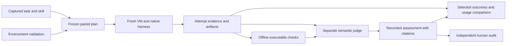

# Architecture

Skilleval is a Python CLI coordinating explicit files: captured inputs, frozen
plans, execution receipts, artifacts, and separately versioned assessments.
It has no database, persistent daemon, or dependency on a sibling checkout.
Runtime execution and inference are explicit opt-in operations.

Development execution, checking, recording, and descriptive comparison are
implemented. Independent audit does not happen automatically, and the current
controller never grants scored-study admission. The
[roadmap](../project/ROADMAP.md) owns the remaining evidence gates.

## Records and ownership

`contracts.py` defines common typed records. Family modules own task, study,
assessment, and accounting contracts; `skilleval schema KIND` exposes supported
schemas. Unknown fields are rejected. A structurally valid record is not proof of
its contents or of relationships to other records.

| Layer | Implementation owner | Contract reference |
| --- | --- | --- |
| Captures and historical imports | `evidence.py` | Evidence below |
| Review workspace reconstruction | `workspace.py` | Native review reconstruction below |
| Task and environment packages | `task_package.py`, `task_validation_guest.py` | [TASKS.md](TASKS.md) |
| Runtime identity, lifecycle and admission | `identity.py`, `qualification.py`, `lifecycle.py`, `admission.py` | [ENVIRONMENT.md](ENVIRONMENT.md) |
| Inference and native execution | `gateway.py`, `runner.py`, `app_server.py`, `harnesses/codex.py` | [GATEWAY.md](GATEWAY.md), [NATIVE.md](NATIVE.md) |
| Skill treatments and paired attempts | `treatments.py`, `study.py` | [STUDIES.md](STUDIES.md) |
| File collection, observations and selection | `repair.py`, `repair_check.py`, `repair_outcomes.py` | [REPAIRS.md](REPAIRS.md), [TASKS.md](TASKS.md) |
| Semantic assessment and judge controls | `grading.py`, `judge.py`, `repair_assessment.py`, `calibration.py`, `reliability.py` | [CALIBRATION.md](CALIBRATION.md), [RELIABILITY.md](RELIABILITY.md) |
| Usage, timing and price scenarios | `accounting.py` | [ACCOUNTING.md](ACCOUNTING.md) |

Study preparation and dispatch check selected inputs and execution identity.
Recording checks the subject, packet, native invocation, artifact bytes, and
citations. Explicit outcome selection joins checked evidence to attempts without
choosing the latest or most favorable judgment.

## Evidence

Capture creates a fresh directory containing payload and `manifest.json`. Entries
retain relative paths, SHA-256, byte counts, and executable flags. Verification
rejects missing/extra files, changed bytes or modes, duplicate and unsafe paths,
links, and nonregular files. JSON checks reject duplicate keys and nonfinite
numbers. Reads and copies are bounded.

Publication uses an atomic no-replace rename. Captured files are made read-only,
but the owner can still modify them. Retain the expected digest separately from
the bundle. This detects drift; it is not a signature, proof of provenance,
atomic multi-file source snapshot, or power-failure durability guarantee. Freeze
source before importing. Original POSIX modes beyond the executable bit are not
retained and cannot establish permission-sensitive behavior.

Historical imports preserve selected case files, original reports, and provenance,
including prior exposure and unverified earlier custody. The whole bundle may
contain grading inputs or private material. Only the intended task source enters
a solver workspace; oracle answers, earlier reports, and provenance stay outside.
A judge receives its separately prepared allowlisted packet.

Native archives are bounded and inspected without extracting or executing them
on the host. The retained host snapshot remains canonical even if the guest
changes its copy. Guest files, logs, and transcripts are untrusted evidence;
hashes establish consistency rather than semantic authenticity. Local restrictive
permissions do not isolate data from other processes with the owner's authority.

## Native review reconstruction

`workspace.py` reconstructs a meaningful review diff from supported schema-1
metadata and full-identity UTF-8 patches. Native Git plumbing checks candidate
blobs and executable modes, reverse-applies the patch, verifies base identities,
and round-trips to the exact candidate tree. Synthetic base/candidate commits
supply the diff; this route does not restore the original repository's history.

Git configuration is isolated. Plumbing avoids checkout, hooks, attributes,
filters, and task-program execution. Unsupported paths, patch forms, mode types,
and case aliases fail closed. Task packages that require historical objects must
capture and validate them separately under the
[task-fidelity contract](ENVIRONMENT.md#task-capture-and-baseline-fidelity).

## Runtime and harness

The current smolvm adapter is pinned to 1.32.3. It accepts hash-pinned local
Docker-save archives and explicit Docker Hub OCI digest references. The registry
restriction avoids this version's automatic packed-machine policy import for
other registries. Host image acquisition and guest network access are distinct.
Colima is an image-building option and an execution alternative to evaluate;
there is no automatic fallback adapter.

The VM protects the host; a separate guest boundary protects controller context
from the solver. The trusted launcher gives native Codex a private filesystem,
PID and hostname view, drops its identity and capabilities, and keeps the
controller, staging archive and relay outside that view. Native Codex becomes
PID 1; its exit tears down detached descendants before trusted file collection.
Native stdio uses pipes without controller file descriptors. See [TASK-PRESENTATION.md](TASK-PRESENTATION.md)
for the allowed filesystem, controls and remaining presentation limits.

Keep smolvm while its measured capabilities support this profile. Switching VM
brands alone would not separate a controller from a solver. A Colima alternative
would need a controller outside the solver container, explicit socket forwarding,
no host mounts, and independently qualified freshness and recovery. Revisit it
if the allowlisted runtime/tool view becomes fragile for representative tasks.

Each VM uses fresh identity and isolated runtime directories, an allowlisted
host process environment, bounded operations, and stop/delete cleanup receipts.
The offline route requests no guest network, host mounts, or secrets. The native
route mounts the declared inference socket. Short temporary runtime HOME paths
avoid macOS Unix-socket path limits. Task staging uses guest disk rather than the
small `/run` filesystem. Effective boundary claims require the corresponding live
controls, including known-positive observations; configuration alone is insufficient.

The host gateway selects an existing ChatGPT login and brokers a fixed native
inference route. No auth cache or provider key enters the guest. The typed wrapper
owns request ceilings, expiry, receipts, and cleanup around the pinned OpenBench
implementation. [GATEWAY.md](GATEWAY.md) owns transport, model/catalog pins,
authentication, and upstream provenance. Prompt instructions are not network or
command-level enforcement.

Harness compatibility is separate from execution identity. Stable patch/minor
Codex releases at or after the adapter baseline within the same major version may
enter qualification. Older, prerelease, unknown, and new-major versions require
adapter work. The actual version is recorded; each changed image/binary still
needs protocol and tool-loop validation. Matched runs require comparable observed
harness identities. The model catalog is independently pinned.

Lifecycle recovery owns the entire VM. Stopping a controller can leave guest work
alive, so cleanup needs same-state inventory evidence. Runtime, source, image, and
configuration drift invalidate prior admission and can prevent recovery under a
changed route. Keep the original route until cleanup finishes. Source images stay
retained; completed runs can prune disposable staging copies. See
[ENVIRONMENT.md](ENVIRONMENT.md) for recovery, retention, and host-loss limits.

## Tasks, treatments and attempts

The [task package](TASKS.md) binds an artifact task to required context, its image,
baseline/reference captures, validation commands, expected observations, and
coverage gaps. Matching declared exceptions does not make a test suite clean.
Repair and document tasks share file collection and independent offline checks;
the native writable-file mode remains named `repair` for compatibility.

`treatments.py` captures a complete selected skill with source URL/revision and
applicable notices. Installation preserves bytes and executable flags in a fresh
guest skill directory. Ordinary task instructions remain; selected-skill and Codex
configuration contamination is rejected by the baseline check. New study plans
freeze the explicit ON invocation prefix; legacy plans retain their original
natural-availability or declared invocation policy.

Conservative detectors inspect actual request exposure and successful native
reads of pinned content. Metadata exposure, body exposure, consultation, and
semantic application remain distinct. Missing matches stay unmeasured. Raw
provider request content is not retained; bounded value-free shape observations
and selected-skill matches support exposure diagnostics.

The [study controller](STUDIES.md) runs randomized adjacent pairs sequentially,
with frozen budgets, bounded retries, a local ownership lock, append-only attempts,
and explicit reconciliation after interruption. Primary comparisons retain first
attempts; successful retries do not replace earlier failures. Unstarted cells and
incomplete cleanup remain visible.

## Assessment and comparison

Executable workers run separately in fresh offline guests; expected answers and
comparison authority stay on the host. File-observation workers are unprivileged,
but candidate imports share that worker's authority. Finite checks do not establish
semantic quality or resistance to adversarial task output.

Review, repair, and document judgments have distinct outcome rubrics. Prepared
packets withhold authored labels and structured treatment/history fields while
preserving evidence; prose and prior exposure can still reveal identity. Static
judging forbids execution by prompt policy. Investigative judging permits bounded
VM reproductions and retains their scripts/results alongside original evidence.
Tools remain available in both policies; the runtime deadline is the execution
boundary.

Recording binds the exact packet, prompt, model, policy, final response, and
artifact inventory. Resolved judgments need substantive original citations;
reproduction results may supplement them. Byte-verified native path aliases are
accepted without rewriting raw citations. Document judgments validate both
citation lists by retained path authority; original repair schemas and packet
bytes remain unchanged. See [TASKS.md](TASKS.md) for that family distinction.

Records append under fresh IDs, retaining earlier versions and explicit
supersession. Missing or malformed reports never become empty clean reports;
failed reviewed executions and failed judge executions stay separate from semantic
verdicts. Native audit status starts at `required-pending`. Neither authored-label
agreement nor another model pass supplies independent human audit.

Reports join explicitly selected checks and judgments with artifacts and usage.
Input includes the cached subset; native cumulative snapshots and broker core
totals must not be double-counted. Price scenarios are conditional estimates,
not observed charges. Task-agent time, setup/cleanup, and selected judge usage
remain separate. Failed or unselected judge invocations require an operational
ledger beyond the selected comparison. Uncertainty and audited task-quality
differences are not yet estimated.
