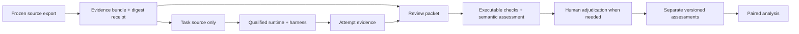

# Architecture

The Python package has five boundaries: typed experimental records, captured
evidence, runtime qualification, harness observations, and separate assessments.
The CLI coordinates them through explicit files. It has no database, daemon,
provider client, or dependency on another local repository.

Runtime qualification, model-backed assessment, and paired analysis in this
diagram are the target flow. Only offline controls, packet preparation, and
assessment storage currently execute.

## Records

`contracts.py` exposes provisional version-1 JSON schemas. Unknown fields are
rejected. Task identifies evidence and development/holdout population. Experiment
declares tasks, harness/model/effort, variants, repetitions, order seed, timeout,
and primary outcomes. A variant distinguishes absent, available, and forced skill
use and pins skill content when present. These are starting contracts, not a
complete admissible campaign specification.

Attempt separates execution status, evidence identity, observed consultation,
origin, and reported usage. Missing usage is null. Assessment names its subject,
evidence digest, rubric, assessor, model when applicable, per-finding judgments,
limitations, and optional superseded record. Structural validation does not
establish the truth of any of these claims or enforce relationships across a full
campaign; orchestration must add those checks.

## Evidence

Capture produces a fresh directory containing payload and `manifest.json`. Each
manifest entry records relative path, SHA-256, byte count, and executable flag.
Verification rejects extra/missing files, changed bytes/modes, duplicate paths,
unsafe paths, links, and nonregular files. JSON controls reject duplicate keys and
nonfinite numbers. Reads and copies are bounded.

Publication uses an atomic no-replace rename. Captured files are made read-only;
the owner can still modify them. Keep the manifest digest outside the bundle to
detect replacement of both manifest and payload. This is integrity checking, not
a signature, provenance proof, multi-file source snapshot, or storage durability
guarantee across power failure. Freeze the source before importing.

Historical imports preserve selected case files and reports plus the original
full report document under `provenance/`. They explicitly record development
population, prior exposure, and unverified earlier custody. The whole bundle can
contain private material. Only `case/source` is eligible for solver transfer;
oracle, reports, and provenance are grading inputs outside that filesystem.

Private records use fresh destinations and restrictive file permissions. These
are local workflow protections, not isolation from the credential-owning user or
another process with the same authority. No scrubber makes arbitrary source or
traces publishable. Release artifacts require an explicit visibility review.

## Runtime and harness

`qualification.py` makes a plan from a verified imported source bundle, immutable
OCI digest, resources, and explicit guest command argv. `run` recomputes the plan
and rejects drift before launching anything. It uses a fresh machine identity,
isolated HOME/XDG/Docker directories, an allowlisted process environment, no host
shell, bounded logs, timeouts, and stop/delete cleanup receipts. It transfers a
hash-checked archive of source files only. Nothing in the imported tree is executed
directly on the host.

The candidate adapter is pinned to the inspected smolvm 1.32.3 CLI. Executable
plans are restricted to explicit `docker.io/` references: this version's pack
resolver skips Docker Hub, while other registry references can automatically
import packed-machine policy, including network settings. Ordinary OCI pulls may
contact a public registry from the host; that is distinct from guest network
policy. The candidate adapter requests no guest network, mounts, or secrets.
Effective enforcement still requires live qualification with positive controls.

The adapter follows the pinned upstream
[machine CLI](https://github.com/smol-machines/smolvm/blob/v1.32.3/src/cli/machine.rs),
[pack resolver](https://github.com/smol-machines/smolvm/blob/v1.32.3/src/data/pack_ref.rs),
and [VM lifecycle](https://github.com/smol-machines/smolvm/blob/v1.32.3/src/cli/vm_common.rs).
Reinspect and requalify before accepting another runtime version or image route.
Colima remains an alternative to evaluate, not an implemented fallback.

`offline_passed` records successful explicit offline controls and cleanup.
`partial` covers failures, incomplete cleanup, or a mismatched runtime. Every
report says `admitted: false`. No installed binary, source-level restriction, or
successful subprocess fixture establishes host isolation or scored-run admission.
Native Git reconstruction, provider authentication, and a real Codex model/tool
loop remain pending. Runtime state is retained for diagnosis/recovery; the CLI
does not automatically retry or resume it.

`harnesses/codex.py` parses captured `codex exec --json` events based on the
[noninteractive event interface](https://learn.chatgpt.com/docs/non-interactive-mode).
It preserves raw/unknown events, per-turn usage observations, item outcomes, and
parse errors. It does not invoke Codex. Turn completion is not task success; failed
tool commands can occur in otherwise completed turns. Malformed evidence makes
stream status unknown. A future adapter must reconcile stream status with the
actual process exit/timeout and aggregate usage with documented semantics.

## Assessment

`grading.py` creates fresh packets, defaulting to no oracle or provenance. Only
selected report fields are copied; report content can still reveal identity or
contain untrusted instructions. The rubric requires source-grounded reasoning,
permits novel defects, rejects lexical reference matching, and allows unresolved
judgments. These instructions alone do not demonstrate prompt-injection resistance.

Recording verifies evidence identity, selected report validity, complete finding
index coverage, citation paths/spans, and same-subject/evidence supersession.
Supported and unsupported findings require citations. Valid report content from a
failed execution can be assessed; invalid/missing reports cannot become clean
reviews. Records append exclusively under unique assessment IDs. Revised records
do not change the source or overwrite prior judgments.

The current grader checks record structure and evidence links. It does not call
an LLM, determine semantic correctness, verify blinding, compute recall, select a
preferred revision, or aggregate scores. Those capabilities require calibrated
judges, declared analysis policies, and targeted human adjudication.
